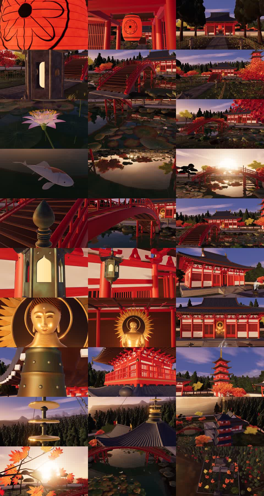

# 黄昏寺庙 · Temple at Dusk

> 零外部 3D 模型、零位图贴图、零照片。纯代码程序化构建的 70 秒黄昏寺庙电影。  
> *A 70-second 1080p procedural film built entirely in Three.js — no 3D models, no image textures, no photos.*

[](../../docs/images/temple-dusk-stills.jpg)

## 影片概览

本片通过 10 个精心设计的 7 秒镜头（总长 70 秒，1080p @ 30fps），以“微观特写起幅，连续加速拉远揭示大景”的统一运镜语言，展现了一座掩映在秋日黄昏群山中的传统寺庙建筑群。

所有场景元素（寺庙大殿、斗栱、五重塔、相轮、铜钟、石灯笼、太鼓桥、拟宝珠、莲花池、锦鲤、群山、枫树与松树）均由 JavaScript 代码纯程序化生成。

### 10 个镜头

| 序号 | 镜头名称 | 特写起点 | 远景落幅 |
|---|---|---|---|
| **01** | 山门 · 红灯笼 | 山门下微风轻晃的红灯笼特写 | 参道仰视山门与远处群山 |
| **02** | 石灯笼 | 苔藓斑驳的石灯笼与烛火 | 青石铺地参道、放生池与大殿前院 |
| **03** | 莲花 | 水面粉色莲花与睡莲叶群 | 荷塘、石岸、太鼓桥侧翼 |
| **04** | 锦鲤 | 浅水游弋的锦鲤与鳞片微光 | 水面夕阳倒影与桥下涵洞 |
| **05** | 拟宝珠 | 桥头铸铜拟宝珠光泽与榫卯木栏 | 太鼓拱桥轴线正对大殿正门 |
| **06** | 吊灯笼 | 飞檐下悬挂的镂空青铜六角灯笼 | 大殿七架梁架、斗栱与屋脊悬鱼 |
| **07** | 佛像面部 | 殿内幽光中低眉慈目的贴金佛面 | 穿透殿门的夕阳斜射佛龛与金堂柱廊 |
| **08** | 风铃 | 五重塔飞檐翼角下摇曳的铜风铃 | 五重塔塔身出挑斗栱与飞檐层叠 |
| **09** | 相轮 | 塔顶九环铜相轮与宝珠截面 | 夕阳逆光中挺拔的塔尖与晚霞轮廓 |
| **10** | 逆光枫叶 | 晶莹剔透的红枫掌状叶脉特写 | 垂直升空大俯瞰，全寺院群山晚景尽收眼底 |

---

## 技术架构

- **纯代码建模（Zero Asset Dependencies）**：
  - 结构：大殿主体（梁、柱、额枋、平柱、角柱）、重檐庑殿顶、斗栱（斗、升、昂、栱组合）、五重塔塔身与相轮。
  - 庭院与水系：太鼓木桥、拟宝珠、放生池、汀步石、御手洗水舍、铜香炉、石灯笼、院墙与板瓦。
  - 自然与植被：程序化枫树（红、橙渐变掌状叶片）、针叶松树、莲池莲叶与荷花、自由游弋锦鲤（路径与摆尾动力学）、分形山体与地势起伏。
- **程序化材质（Procedural Shading）**：
  - 木材：基于多频噪声的木纹凹凸与粗糙度变化。
  - 青铜与金属：带氧化铜绿（Verdigris）的拟宝珠与风铃着色。
  - 纸与灯光：透光的红灯笼与暖色点光源。
  - 水面：基于法线微扰与菲涅尔反射的水体计算。
- **运镜系统（Cinematic Camera Rig）**：
  - 非对称 Sigmoid 加速曲线（Asymmetric Sigmoid Pull Curve）：起幅 16% 时间维持特写慢速缓动（Hold Drift），随后以平滑加速度拉远退入环境全景，终幅平缓减速入定。
  - 空间目标锚点系统：镜头焦点自微观物理锚点（Anchor）自然过渡至大场景空间观察中心。

---

## 运行与渲染

```bash
# 安装依赖
npm install

# 启动本地预览服务器 (访问 http://localhost:8130)
npm run serve

# 渲染单帧截帧 (用于打光与构图调试)
npm run still

# 运行自动化几何与材质检查
npm run check

# 本地无头浏览器逐帧渲染与合流
npm run render
```
